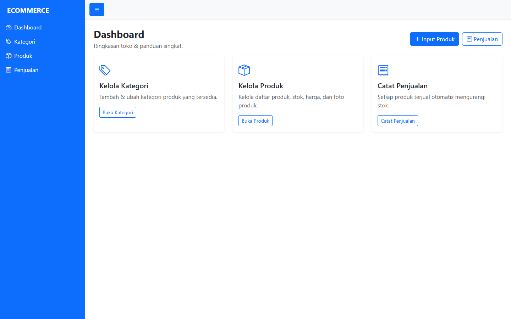
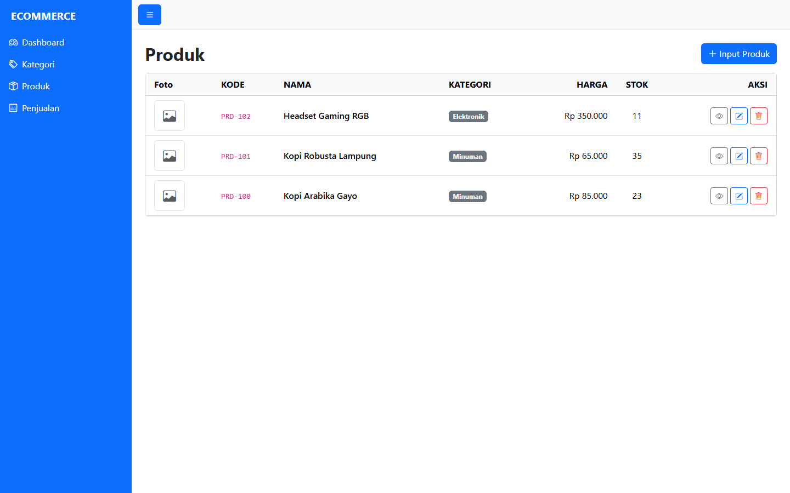
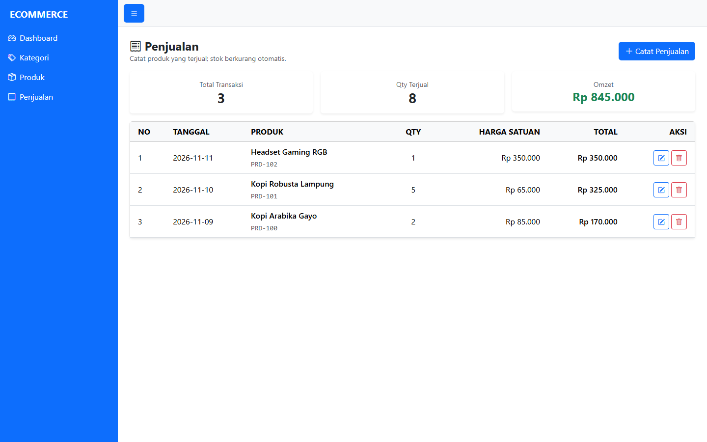
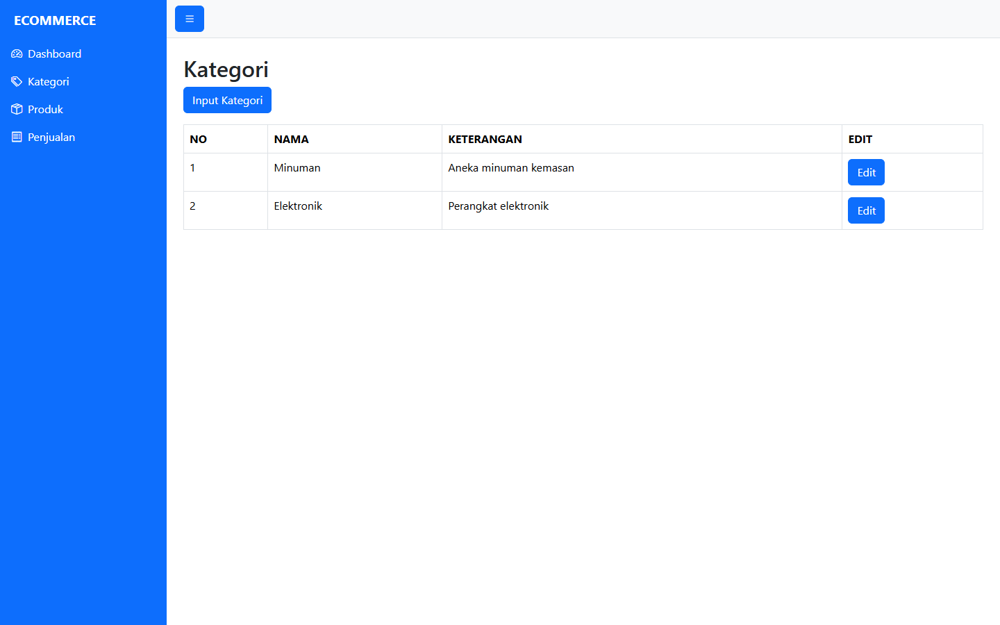
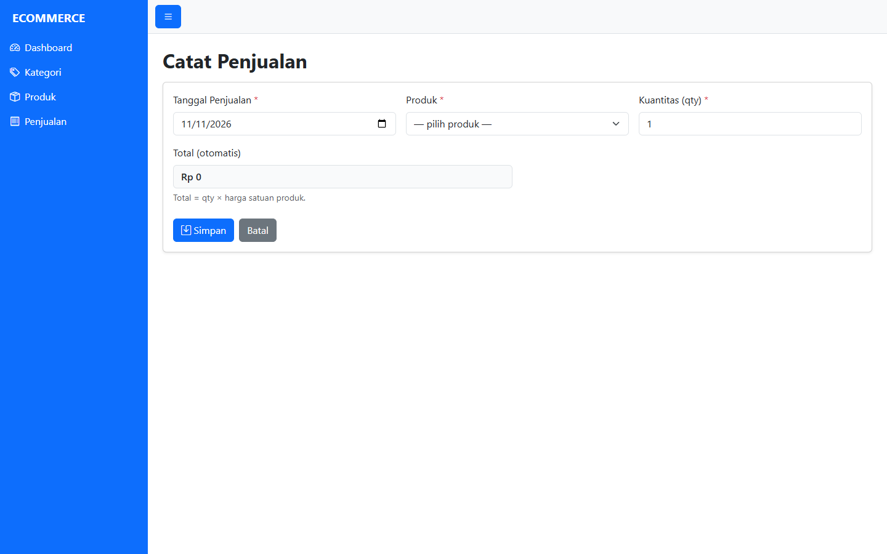
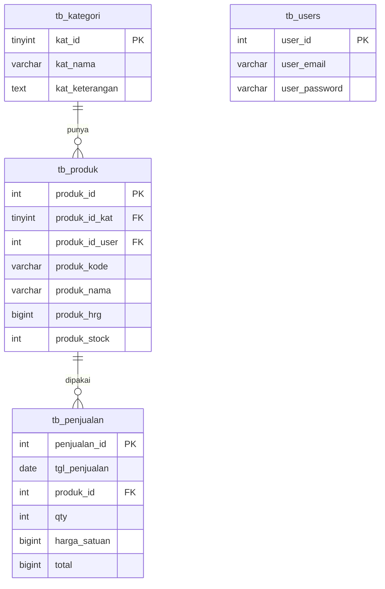

<div align="center">

# 🛒 E-Commerce — PHP Native

**Project 6 · Pemrograman Berbasis Web Lanjutan**

Aplikasi **e-commerce sederhana** dengan **MVC buatan sendiri**: **Kategori**, **Produk**, dan **Penjualan** — tanpa framework.

> Versi **1.1.0**: autentikasi dihapus (akses terbuka) + penambahan tabel & modul **Penjualan**.


</div>

---

## 📖 Deskripsi

Proyek PHP **MVC murni** (tanpa framework) untuk mengelola toko sederhana:

- **Kategori** — daftar/tambah/ubah kategori produk
- **Produk** — kelola produk + **unggah foto**
- **Penjualan** — catat penjualan; total otomatis (**qty × harga_satuan**), **stok berkurang otomatis** (dalam transaksi aman)

> Versi awal memakai autentikasi (`password_hash`). Pada **v1.1.0** autentikasi dihapus sesuai kebutuhan praktikum — halaman kini terbuka untuk semua.

## 📸 Tampilan

<table>
  <tr>
    <td width="50%"><br><sub>Dashboard</sub></td>
    <td width="50%"><br><sub>Produk</sub></td>
  </tr>
  <tr>
    <td width="50%"><br><sub>Penjualan (baru)</sub></td>
    <td width="50%"><br><sub>Kategori</sub></td>
  </tr>
  <tr>
    <td colspan="2" align="center"><br><sub>Form Catat Penjualan</sub></td>
  </tr>
</table>

## ✨ Fitur

### 🗂️ Kategori
- Daftar, tambah, ubah

### 📦 Produk
- Daftar + kategori (JOIN), detail
- Tambah (dengan **unggah foto**), ubah, hapus
- Harga & stok tervalidasi, kode unik, foto lama dibersihkan

### 🧾 Penjualan (baru)
- Daftar penjualan + ringkasan (**Total Transaksi / Qty Terjual / Omzet**)
- Tambah, ubah, hapus
- **Stok produk berkurang/ditambah otomatis** (terkunci dengan `SELECT ... FOR UPDATE`)
- Total otomatis = kuantitas × harga satuan
- Perubahan qty saat edit menyesuaikan selisih stok

### 🛡️ Validasi & Integritas
- Foreign key `tb_produk → tb_penjualan` mencegah hapus produk yang sudah dipakai
- Transaksi database (rollback otomatis bila gagal)
- Escaping XSS di semua tampilan

## 🧱 Teknologi

| Lapisan | Teknologi |
| --- | --- |
| Bahasa | PHP 8.0+ (MVC buatan sendiri) |
| Database | MySQL / MariaDB (PDO, prepared statement) |
| Tampilan | Bootstrap 5 + Bootstrap Icons |
| Paket PHP | `filp/whoops` |

## 🏗️ Alur Penjualan

```mermaid
sequenceDiagram
    participant U as Pengguna
    participant C as Penjualan (Controller)
    participant M as Penjualan (Model)
    participant DB as MySQL
    U->>C: POST /penjualan/simpan
    C->>M: simpan()
    M->>DB: BEGIN; SELECT ... FOR UPDATE (produk)
    M->>M: cek stok ≥ qty
    M->>DB: INSERT tb_penjualan (total = qty × harga)
    M->>DB: UPDATE tb_produk SET produk_stock = produk_stock - qty
    M->>DB: COMMIT
    C-->>U: redirect /penjualan + flash sukses
```

## 🗺️ Skema Database (v1.1.0)



> `tb_users` tetap ada karena `tb_produk.produk_id_user` memiliki FK wajib ke `tb_users` (dipakai untuk praktikum relasi).

## 📁 Struktur Folder

```
project6/
├── index.php
├── .htaccess                 # URL rapi: /kategori, /produk, /penjualan
├── inc/
│   └── config.php            # URL dasar, autoload, session
├── app/
│   ├── core/{Bootstrap,Controller,Model,Error}.php
│   ├── controllers/
│   │   ├── Index.php         # redirect → /dashboard
│   │   ├── Dashboard.php
│   │   ├── Kategori.php      # bypass autentikasi
│   │   ├── Produk.php        # bypass autentikasi + CRUD + upload
│   │   └── Penjualan.php     # ← BARU: CRUD penjualan
│   ├── models/
│   │   ├── Kategori.php
│   │   ├── Produk.php
│   │   └── Penjualan.php     # ← BARU: stok aman + transaksi
│   └── views/
│       ├── dashboard/, kategori/, produk/
│       └── penjualan/{index,input,edit}.php  # ← BARU
├── layouts/
│   ├── login.php             # (tidak dipakai lagi; bypass)
│   └── dashboard.php         # sudah ada menu Penjualan
├── uploads/produk/           # foto unggahan (tidak di-commit)
├── composer.json
└── database.sql              # tb_kategori, tb_users, tb_produk, tb_penjualan
```

## ⚙️ Persyaratan

- **PHP 8.0+** dengan `pdo_mysql` dan `fileinfo`
- **MySQL / MariaDB**
- **Apache** dengan `mod_rewrite` aktif
- **Composer**

## 🚀 Instalasi & Menjalankan

1. **Letakkan folder** di `C:\xampp\htdocs\project6`.

2. **Pasang dependensi**:
   ```bash
   cd project6
   composer install
   ```

3. **Buat database** `dbproject6`.

4. **Import** `database.sql` (membuat `tb_kategori`, `tb_users`, `tb_produk`, `tb_penjualan` + data contoh).

5. **Sesuaikan koneksi** di `app/core/Model.php`:
   ```php
   new PDO("mysql:host=127.0.0.1;port=3307;dbname=dbproject6;charset=utf8mb4", "root", "")
   ```
   *(untuk lingkungan non‑praktikum, sesuaikan host/port/user/password)*

6. **Sesuaikan URL** di `inc/config.php`:
   ```php
   define("URL", "http://localhost/project6");
   ```

7. **Buka** `http://localhost/project6/` → langsung masuk Dashboard (tanpa login).

## 🔐 Kredensial

Aplikasi **tidak lagi memakai autentikasi** — semua halaman terbuka.

> `tb_users` tetap ada (dibutuhkan FK `tb_produk.produk_id_user`) dan tetap memiliki akun admin latihan `admin@mail.com` / `admin123`, namun halaman login sudah **tidak dipakai**.

## 🧭 Halaman

| URL | Keterangan |
| --- | --- |
| `/project6/` | Redirect → Dashboard |
| `/project6/dashboard` | Dashboard ringkasan |
| `/project6/kategori` | Kelola kategori |
| `/project6/produk` | Kelola produk |
| `/project6/penjualan` | ← **BARU**: Daftar penjualan + ringkasan |
| `/project6/penjualan/input` | Catat penjualan |
| `/project6/penjualan/edit/{id}` | Ubah penjualan |
| `/project6/penjualan/hapus/{id}` | Hapus penjualan (stok dikembalikan) |

## 🗄️ Skema Tabel (ringkas)

| Tabel | Kolom penting |
| --- | --- |
| `tb_kategori` | `kat_id`, `kat_nama`, `kat_keterangan` |
| `tb_users` | `user_id`, `user_email` (unik), `user_password` (bcrypt), `user_nama` |
| `tb_produk` | `produk_id`, `produk_kode` (unik), `produk_nama`, `produk_hrg`, `produk_stock`, `produk_photo`, FK → kategori, FK → users |
| `tb_penjualan` | `penjualan_id`, `tgl_penjualan`, `produk_id` (FK), `qty`, `harga_satuan`, `total` |

## 🧪 Pengujian (sudah dilakukan)

- ✅ Akses semua halaman **tanpa login**: 200/302 sesuai harapan
- ✅ Penjualan dibuat → stok berkurang benar (25 → 23)
- ✅ Update qty (2 → 3) → total menjadi 255.000, stok 23 → 22
- ✅ Hapus penjualan → stok kembali (22 → 25)
- ✅ Proteksi FK: hapus produk yang sudah terjual ditolak
- ✅ Total dihitung otomatis: 2 × 85.000 = 170.000

## 📄 Lisensi

Dirilis di bawah lisensi **[MIT](LICENSE)**.

## 🙏 Kredit

Berdasarkan materi praktikum **Pemrograman Berbasis Web Lanjutan**, S1 Sistem Informasi — UIN Sumatera Utara Medan (Dosen: Suendri, M.Kom).
