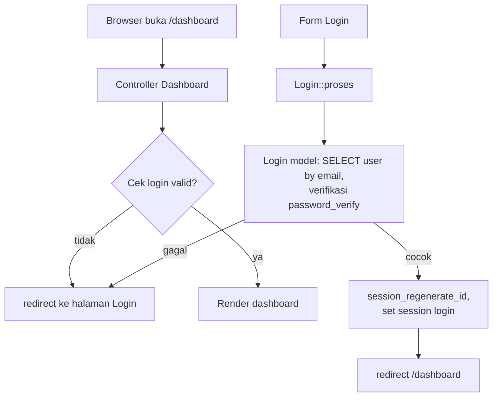

<div align="center">

# 🔐 E-Commerce MVC + Autentikasi — PHP Native

**Project 6 · Pemrograman Berbasis Web Lanjutan**

Versi lanjutan dari project MVC: kini dengan **Login, Session, Logout, dan proteksi halaman** — plus CRUD **Kategori** & **Produk** (unggah foto).


-critical)


</div>

---

## 📖 Deskripsi

Proyek ini melanjutkan pola **MVC buatan sendiri** dari project sebelumnya, lalu menambahkan **lapisan autentikasi**: pengguna harus login dulu sebelum bisa mengakses dashboard, kategori, dan produk.

Autentikasi pada versi awal memakai fungsi SQL `PASSWORD()` yang **sudah dihapus** di MySQL 8/MariaDB modern sehingga login gagal. Repo ini menggantinya dengan mekanisme modern **`password_hash()` / `password_verify()` (bcrypt)**, menambah proteksi ke semua controller sensitif, dan melengkapi CRUD Produk.

## ✨ Fitur

### 🔐 Autentikasi
- Login dengan email + password (verifikasi **bcrypt**)
- `session_regenerate_id()` saat login (mencegah session fixation)
- Menyimpan `user_id` & `user_nama` di session
- **Logout** membersihkan session + cookie
- **Proteksi halaman**: Dashboard, Kategori, dan Produk tidak bisa diakses tanpa login

### 🗂️ Kategori
- Daftar, tambah, ubah

### 📦 Produk (lengkap)
- Daftar + kategori (JOIN), detail, tambah (dengan **unggah foto**), ubah, hapus
- Harga & stok tervalidasi, kode unik, foto lama dibersihkan
- Menyimpan siapa pembuat produk (`produk_id_user` dari session)

## 🧱 Teknologi

| Lapisan | Teknologi |
| --- | --- |
| Bahasa | PHP 8.0+ (MVC buatan sendiri) |
| Database | MySQL / MariaDB (PDO, prepared statement) |
| Auth | `password_hash()` / `password_verify()` (bcrypt) |
| Tampilan | Bootstrap 5 + Bootstrap Icons (aset lokal) |
| Paket PHP | `filp/whoops` |

## 🏗️ Arsitektur & Alur Login



## 📁 Struktur Folder

```
project6/
├── index.php
├── .htaccess                     # URL rapi
├── inc/
│   └── config.php                # URL dasar, autoload, session
├── app/
│   ├── core/
│   │   ├── Bootstrap.php         # Router
│   │   ├── Controller.php        # Render view + cekLogin()
│   │   ├── Model.php             # Koneksi PDO
│   │   └── Error.php
│   ├── controllers/
│   │   ├── Index.php             # Arahkan ke login/dashboard
│   │   ├── Login.php             # ← autentikasi
│   │   ├── Dashboard.php         # cekLogin + logout
│   │   ├── Kategori.php          # cekLogin + CRUD
│   │   └── Produk.php            # cekLogin + CRUD
│   ├── models/
│   │   ├── Login.php             # ← password_verify
│   │   ├── Kategori.php
│   │   └── Produk.php
│   └── views/
│       ├── login/index.php
│       ├── dashboard/
│       ├── kategori/
│       └── produk/
├── layouts/
│   ├── login.php
│   ├── dashboard.php
│   └── assets/
├── uploads/
│   ├── .htaccess                 # Blokir eksekusi skrip
│   └── produk/
├── vendor/                       # (tidak di-commit)
├── composer.json
└── database.sql                  # tb_kategori, tb_users, tb_produk
```

## ⚙️ Persyaratan

- **PHP 8.0+** dengan `pdo_mysql` dan `fileinfo`
- **MySQL / MariaDB** (bukan MySQL/MariaDB yang sudah menghapus `PASSWORD()` — repo ini tidak memakainya)
- **Apache** dengan `mod_rewrite`
- **Composer**
- Folder `uploads/` writable

## 🚀 Instalasi & Menjalankan

1. **Letakkan folder** di `C:\xampp\htdocs\project6`.

2. **Pasang dependensi**:
   ```bash
   cd project6
   composer install
   ```

3. **Buat database** `dbproject6`.

4. **Import** `database.sql` (membuat `tb_kategori`, `tb_users`, `tb_produk` + akun admin).

5. **Sesuaikan koneksi** di `app/core/Model.php`:
   ```php
   new PDO("mysql:host=127.0.0.1;port=3307;dbname=dbproject6;charset=utf8mb4", "root", "")
   ```

6. **Sesuaikan URL** di `inc/config.php`:
   ```php
   define("URL", "http://localhost/project6");
   ```

7. **Buka** `http://localhost/project6/` → muncul halaman Login.

## 🔐 Kredensial

```
Email    : admin@mail.com
Password : admin123
```

> ⚠️ Ini kredensial **praktikum/latihan** yang sudah ter-seed di `database.sql` (hash bcrypt). Untuk pemakaian nyata, ganti password & jangan simpan kredensial di repo.

Cara membuat akun sendiri (opsional):
```sql
-- Ganti <HASH> dengan hasil: php -r "echo password_hash('passwordbaru', PASSWORD_DEFAULT);"
INSERT INTO tb_users (user_email, user_password, user_nama)
VALUES ('email@kamu.com', '<HASH>', 'Nama Kamu');
```

## 🧭 Halaman

| URL | Akses | Keterangan |
| --- | --- | --- |
| `/project6/` | publik | Login (atau langsung dashboard bila sudah login) |
| `/project6/dashboard` | 🔒 | Dashboard |
| `/project6/kategori` | 🔒 | Kelola kategori |
| `/project6/produk` | 🔒 | Kelola produk |
| `/project6/dashboard/logout` | 🔒 | Keluar |

## 🗄️ Skema Database

| Tabel | Kolom penting |
| --- | --- |
| `tb_users` | `user_id`, `user_email` (unik), `user_password` (**VARCHAR 255**, bcrypt), `user_nama` |
| `tb_kategori` | `kat_id`, `kat_nama`, `kat_keterangan` |
| `tb_produk` | `produk_id`, `produk_id_kat` (FK), `produk_id_user` (FK), `produk_kode` (unik), `produk_nama`, `produk_hrg`, `produk_stock`, `produk_photo` |

## 🧪 Pengujian yang Sudah Dilakukan

- ✅ Akses tanpa login ke `/dashboard`, `/kategori`, `/produk` → **dipantulkan ke halaman login**
- ✅ Login salah → pesan error; login benar → masuk dashboard
- ✅ Login benar memakai `password_verify()` (bcrypt) — diverifikasi langsung
- ✅ CRUD Produk + unggah foto → `produk_id_user` terisi otomatis dari session
- ✅ Logout → session hancur, akses kembali ditolak

## 🔧 Yang Diperbaiki dari Versi Awal

1. **Login diperbaiki** — `PASSWORD()` MySQL diganti `password_hash()`/`password_verify()`; kolom password dilebarkan ke `VARCHAR(255)`; akun admin di-seed dengan hash bcrypt.
2. **Proteksi akses ditambahkan** — `cekLogin()` kini dipanggil di controller Kategori & Produk (sebelumnya hanya Dashboard, sehingga halaman sensitif bisa diakses tanpa login).
3. **Session diperkuat** — `session_regenerate_id(true)` saat login; logout membersihkan cookie.
4. **CRUD Produk dilengkapi** + unggah foto & validasi.
5. **Perbaikan bug** router root URL dan redirect kategori; escaping XSS.

## 🩺 Troubleshooting

| Gejala | Solusi |
| --- | --- |
| Login selalu gagal | Pastikan record `tb_users` memakai hash **bcrypt** (bukan `PASSWORD()` lama) |
| `SELECT ... PASSWORD(...)` error | Anda memakai versi database yang menghapus `PASSWORD()` — repo ini sudah tidak memakainya |
| Aset/tampilan rusak | Periksa nilai `URL` di `inc/config.php` |
| Foto tidak muncul | Pastikan folder `uploads/produk/` ada & writable |
| `Class not found` | Jalankan `composer install` |

## 📄 Lisensi

Dirilis di bawah lisensi **[MIT](LICENSE)**.

## 🙏 Kredit

Berdasarkan materi praktikum **Pemrograman Berbasis Web Lanjutan** (kode awal oleh *Suendri*). Versi ini memperbaiki autentikasi (bcrypt), menambah proteksi akses, dan melengkapi CRUD Produk.
